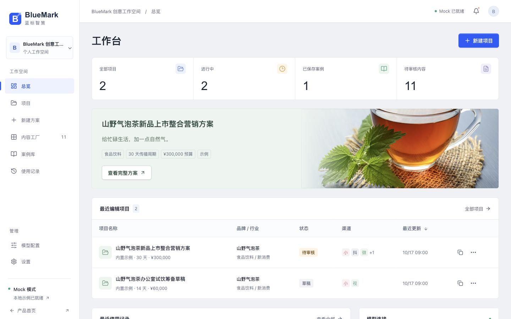

# 蓝标智策 BlueMark

从营销 Brief 到可执行营销方案的智能工作台。面向品牌团队和营销服务公司，提供结构化策划、内容审核、案例复用和方案导出。仅提供响应式网页端，不包含桌面客户端或移动端应用。

**本项目默认支持 Mock 模式，无需 API Key 即可运行完整 Demo；配置 OpenAI-Compatible API 后，可以切换为真实模型生成模式。**

这是独立面试展示项目，与蓝色光标 / BlueFocus 无官方隶属、合作或背书关系。内置品牌、项目和历史记录为虚构示例，不能作为真实客户案例或实际投放成果。

## 本地运行

使用 Node.js >=22 和 npm，在项目根目录执行：

```bash
npm ci
npm run dev
```

打开 [产品首页](http://127.0.0.1:5173/) 或 [工作台](http://127.0.0.1:5173/app)。该命令同时启动 Vite 网页服务和 `127.0.0.1:8787` Node 代理；默认无需配置密钥。

1. 首次演示：进入「案例库」，打开山野气泡茶，检查内容、排期和 KPI，然后复制为新项目。
2. 创建方案：进入「新建方案」，填写六步 Brief，或使用案例模板，再提交生成。
3. 交付演示：编辑内容并逐条审核，确认模块与高风险项，再标记可交付。项目详情可导出 Markdown、JSON、HTML；设置页可导出工作空间备份。
4. 默认端口被占用时，不要关闭不明进程。可分别运行 `npm start` 和 `npx vite --host 127.0.0.1 --port 5174`，代理仍使用 8787。

```bash
npm run typecheck
npm test
npm run build
npm test -- src/store.test.ts src/export.test.ts
npm run preview
```

`preview` 仅预览构建后的静态网页，不启动 `/api` 代理。需要本机完整构建服务时执行 `npm run build`，再执行 `NODE_ENV=production npm start`，访问 `http://127.0.0.1:8787`。

## 使用场景

BlueMark 用于从 Brief 编写策划草案、拆分多平台内容和复用既有方案。它不负责自动发布、广告投放或采集平台实绩。

| 场景             | 可操作成果                                                 |
| ---------------- | ---------------------------------------------------------- |
| 新品上市提案     | 用户洞察、策略、创意、矩阵、排期和 KPI 规划                |
| 内容团队协作演示 | 内容筛选、负责人字段、编辑、批量审核和导出；非真实多人协作 |
| 案例复用         | 新建项目和内容 ID、保留方案、标记来源、重置人工审核        |
| 面试展示         | 展示营销业务拆解、Agent 编排、模型接入和可验证的工程交付   |

## 页面结构

展示页、工作台和案例详情是独立页面。路径使用 BrowserRouter，不是 HashRouter。

| 路由                | 页面                                     |
| ------------------- | ---------------------------------------- |
| `/`、`/landing`     | 产品介绍与工作台预览                     |
| `/app`              | 总览                                     |
| `/app/projects`     | 项目列表、搜索、状态和行业筛选           |
| `/app/projects/new` | 六步 Brief、暂存、模板和生成             |
| `/app/projects/:id` | 项目详情、模块编辑、生成进度、审核和导出 |
| `/app/content`      | 内容工厂、筛选、编辑、批量审核和导出     |
| `/app/cases`        | 案例库、收藏与筛选                       |
| `/app/cases/:id`    | 案例详情与复制为新项目                   |
| `/app/usage`        | 使用记录、项目/操作/时间筛选             |
| `/app/model-config` | 模型参数、会话 Key 和连接测试            |
| `/app/settings`     | 工作空间、默认选项、备份和本地重置       |

## 核心功能

项目、方案和内容共享一套数据，而非独立的静态展示卡片。

1. 项目支持创建、编辑、复制、归档、删除；状态包含草稿、生成中、待审核、已完成、已归档。
2. 内容关联所属项目，支持标题与正文编辑、单条重生成、审核、标记修改和选中导出。修改内容后需要重新审核。
3. 案例保留 Brief、方案、模型、时间和操作记录；复制后保留内容并重置审核，不继承“可交付”结论。
4. 使用记录区分内置示例与当前浏览器中的真实操作。生成成功代表输出已校验保存，不代表投放成功。
5. 导出包含项目信息、Brief、洞察、策略、创意、矩阵、平台内容、排期、KPI、风险和使用记录。JSON 保留数据结构；HTML 转义业务文本，不能把输入当 HTML 执行。

## 内置案例

「山野气泡茶新品上市整合营销方案」是完整的虚构策划样例，预算与 KPI 仅为规划，实际数据为“未采集”。

1. 产品为低糖东方植物气泡饮，面向 22 至 35 岁城市年轻白领；周期 30 天，规划预算 30 万元。
2. 重点渠道为小红书、抖音、微信公众号和视频号，另提供微博文案作为扩展渠道示例。
3. 样例包含三个创意方向、至少 11 条平台内容、四阶段传播排期、指标口径和合规风险。示例日志不是本机真实执行证据。
4. 市场判断、用户假设和目标值需要调研与业务负责人确认。低糖不等于无糖，不承诺健康功效、销售转化或合规保证。

## Agent 工作流

工作流是固定的结构化任务编排，不是自主联网调研 Agent。每一步使用 Brief、已有方案和项目 ID，校验后只保存该模块结果。

```text
校验 Brief → 用户洞察 → 市场分析 → 机会识别 → 品牌定位
→ 营销策略 → 创意方向 → 内容矩阵 → 平台内容
→ 传播排期 → KPI 规划 → 合规检查 → 方案质检
→ 保存方案与使用记录 → 人工审核 → 导出
```

1. 步骤状态为 pending / running / success / error，并记录尝试次数、时间和错误。失败保留已保存结果，支持单模块重试；继续生成从首个未完成步骤开始。
2. 刷新时不恢复后台任务：生成中项目恢复草稿，运行中步骤标记中断，需要用户重试。
3. MockProvider 根据输入生成确定性的结构化模板，不调用外部模型或验证市场事实；相同输入不保证产生新创意。
4. OpenAICompatibleProvider 调用本机 `/api`，由代理发送 Chat Completions `response_format: { type: 'json_object' }`。JSON mode 不保证业务字段正确，任务级 Zod Schema 会继续校验。
5. 仅对完整对象做有限 JSON 格式修复；截断、字段错误、超时或上游拒绝均报错，不伪造成功结果。真实请求失败不会静默退回 Mock。

## 真实模型配置

已实现共享 Provider 接口，无需改写业务页面或删除 MockProvider。模型兼容性仍需用自己的服务实际验证；测试通过不等于已完成真实供应商联调。

1. 推荐方式：将 `.env.example` 复制为本地 `.env`，填写服务端 `AI_API_KEY`、`AI_BASE_URL` 和 `AI_MODEL`，重启 Node 服务。
2. 打开「模型配置」，关闭 Mock，保存配置，再主动点击「测试连接」。服务端存在 Key 时，服务端配置覆盖网页模型配置；状态接口只返回是否配置及模型名。
3. 临时演示方式：在网页密码框输入 Key。Key 仅保留在本次页面会话内存，刷新后清空，不写入 localStorage 或正常导出；请求时仍会发送给本机代理与指定模型服务。
4. 当真实模式预检确认服务端和网页均无 Key 时，会明确提示并切回 Mock。代理不可达或真实请求失败时只报错，需用户重试或主动切换 Mock。
5. Base URL 填接口根路径，例如 `https://api.deepseek.com/v1`，不要重复填写 `/chat/completions`。服务必须支持对应模型的 JSON mode。
6. 公网模型地址强制 HTTPS。HTTP 仅用于服务端显式设置 `ALLOW_LOCAL_AI=true` 后的回环地址，不允许以此访问私网设备。

### 环境变量

密钥只使用服务端 `AI_*`，不要使用 `VITE_AI_API_KEY` 或其他 `VITE_*` 密钥。Vite 前缀变量会进入浏览器构建产物。

| 变量             | 用途 / 默认                                              |
| ---------------- | -------------------------------------------------------- |
| `AI_API_KEY`     | 服务端模型密钥，默认空                                   |
| `AI_BASE_URL`    | 服务端 API 根地址，默认 `https://api.deepseek.com/v1`    |
| `AI_MODEL`       | 服务端模型名，默认 `deepseek-chat`                       |
| `AI_TEMPERATURE` | 可选，默认 0.7，范围 0 至 2                              |
| `AI_MAX_TOKENS`  | 可选，默认 6000，上限 16384                              |
| `AI_TIMEOUT`     | 可选，默认 90 秒，范围 1 至 180                          |
| `ALLOW_LOCAL_AI` | 显式设为 `true` 才允许 loopback 模型地址；不放开整个私网 |
| `PORT`           | Node 服务端口，默认 8787；开发 Vite 代理目标固定为 8787  |
| `NODE_ENV`       | `production` 时 Node 同时服务 `dist` 和 SPA 回退         |
| `VITE_BASE_PATH` | 公开构建路径，默认 `/`；子目录静态部署如 `/bluemark/`    |

## GitHub 与部署

以下是准备上传与部署的说明，不代表已经创建仓库、推送或发布。现有 CI 仅验证，不包含部署步骤。

1. 上传前执行检查与构建，检查待提交文件。排除 `.env`、密钥、个人备份、浏览器数据、`node_modules` 和 `dist`；提交源码、`package-lock.json` 与 `.env.example`。
2. 在 GitHub 创建自己的仓库，再按仓库给出的命令初始化 Git、添加 remote 并推送。推送是对外操作，应在确认仓库可见性和内容后由项目所有者执行。
3. 静态演示推荐 Netlify 或 Vercel：构建命令 `npm run build`，产物目录 `dist`。仓库提供 `public/_redirects` 和 `vercel.json` 处理 SPA 路由回退。**静态托管仅支持 Mock，不部署 Node `/api` 代理。**
4. GitHub Pages 项目站点需在构建时设置 `VITE_BASE_PATH=/仓库名/`。当前使用 BrowserRouter，basename 不能解决直接刷新子路由的 404；发布前需额外将 `dist/index.html` 复制为 `dist/404.html`，并验收直接访问 `/仓库名/app`。这是 Pages 404 回退方案，可能仍返回 404 HTTP 状态；当前 CI 不执行该发布步骤，也未改用 HashRouter。
5. 本机完整模式使用 `NODE_ENV=production npm start`。服务绑定 loopback，并限制本机同源请求，不是可直接公开部署的多用户后端。公网生产部署须先完成鉴权、可信域名与反向代理策略、限流和密钥管理，不要简单放开监听地址或删除来源校验。

## 截图与素材

工作台截图路径为 `public/assets/workspace-preview.png`，已从实际运行的网页截取。案例 KPI 截图见 `docs/case-kpi.png`。



案例概念配图位于 `public/assets/shanye-campaign.jpg`，来源为 [Pexels 图片页面](https://www.pexels.com/photo/clear-glass-cup-with-tea-1417945/)，[原图地址](https://images.pexels.com/photos/1417945/pexels-photo-1417945.jpeg)。它是茶饮场景照片，不是山野气泡茶真实包装、产品或客户素材；再次发布素材前应复核适用授权条件。

## 技术架构

前端使用 React、TypeScript、Vite、React Router、Zustand、Lucide 与原生 CSS；Node.js / Express 负责模型代理。数据契约与任务 Schema 由前后端共享，详见 [架构说明](docs/architecture.md)。

```text
bluemark/
├── src/
│   ├── main.tsx / App.tsx          # 路由与工作台外壳
│   ├── domain.ts                  # 类型与工作流步骤
│   ├── data.ts / data.test.ts      # 虚构案例和动态 Mock
│   ├── engine.ts / engine.test.ts  # Provider、提示词、任务校验
│   ├── persistence.ts             # 本地数据结构校验
│   ├── store.ts / store.test.ts    # 状态、编排、持久化回归
│   ├── export.ts / export.test.ts  # 导出与 HTML 转义回归
│   ├── components/ui.tsx          # 公共控件
│   ├── pages/                     # 展示、项目、Brief、详情、运营页面
│   └── styles.css                 # 全局网页样式
├── server/
│   ├── index.ts                   # Express 入口与生产静态服务
│   └── proxy.ts / proxy.test.ts   # /api、安全边界、模拟上游测试
├── public/assets/                 # 照片与实际界面截图
├── public/_redirects / vercel.json # 静态 SPA 回退
├── docs/architecture.md
├── .github/workflows/ci.yml        # 安装、类型检查、测试、构建；无部署
├── .env.example / .gitignore
└── package.json / package-lock.json / vite.config.ts / tsconfig.json
```

## 数据持久化

工作空间保存在当前浏览器当前 origin 的 localStorage，键为 `bluemark.workspace.v1`，不是云数据库或浏览器间同步服务。

1. 保存项目、案例标记、方案内容、步骤、审核状态、使用记录、非密钥模型配置、设置和 Brief 草稿。API Key 写入前清空，读取旧数据时也清空。
2. 自动暂存开关控制 Brief 与内容编辑草稿。内容工厂弹窗中的未提交编辑按内容 ID 另存为 `bluemark.content-draft.v1:*`，重开时可恢复；它不替代正式内容保存，不代表审核通过。项目详情中的模块编辑需要明确保存。
3. 保存前后的业务数据仍可能包含未发布方案与客户信息。更换域名、端口、浏览器或清空站点数据不会自动迁移；使用 JSON 备份。当前不提供完整备份导入恢复流程。
4. 数据结构无效时加载示例并提示错误，阻止自动覆盖原始存储，先备份再处理。配额不足时保留内存数据并显示保存失败，不保证刷新后保留。

## 安全与生产化

当前范围是单浏览器、本地用户的可运行 Demo。没有真实登录、RBAC、租户隔离、云端数据库、不可篡改审计、投放平台连接或实绩采集。

1. API Key 不应提交到 GitHub；生产环境建议使用后端代理和服务端密钥管理。当前已使用本机代理，但它不等于生产级安全服务。
2. 模型生成会向指定供应商发送 Brief 与相关已有方案。提交前移除个人信息、商业秘密和未经授权的客户资料；会话内存 Key 仍可能被浏览器脚本或开发者工具读取。
3. 代理限制来源、请求大小、超时和目标地址，禁止自动重定向，并校验输出。它不能代替身份认证、额度控制、供应商数据协议或人工合规审核。
4. 建议生产化顺序：身份认证与用户/工作空间/项目权限 → 服务端数据库与版本冲突处理 → 后台任务、取消与重试 → 审计、限流和成本配额 → 真实数据源、指标归因与评测。
5. 测试中的模型与网络响应为本地 mock，不证明真实服务商调用成功。未使用付费模型验证时，不将示例结果或连接预检描述为真实联调成果。

## 验收记录

当前交付的构建、自动化与网页实际操作证据见 [验收记录](docs/verification.md)。运行测试不会调用真实模型或发布内容。
